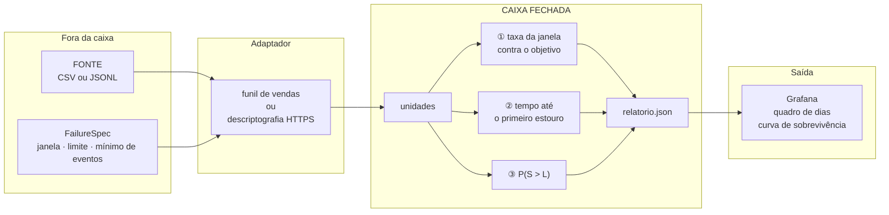
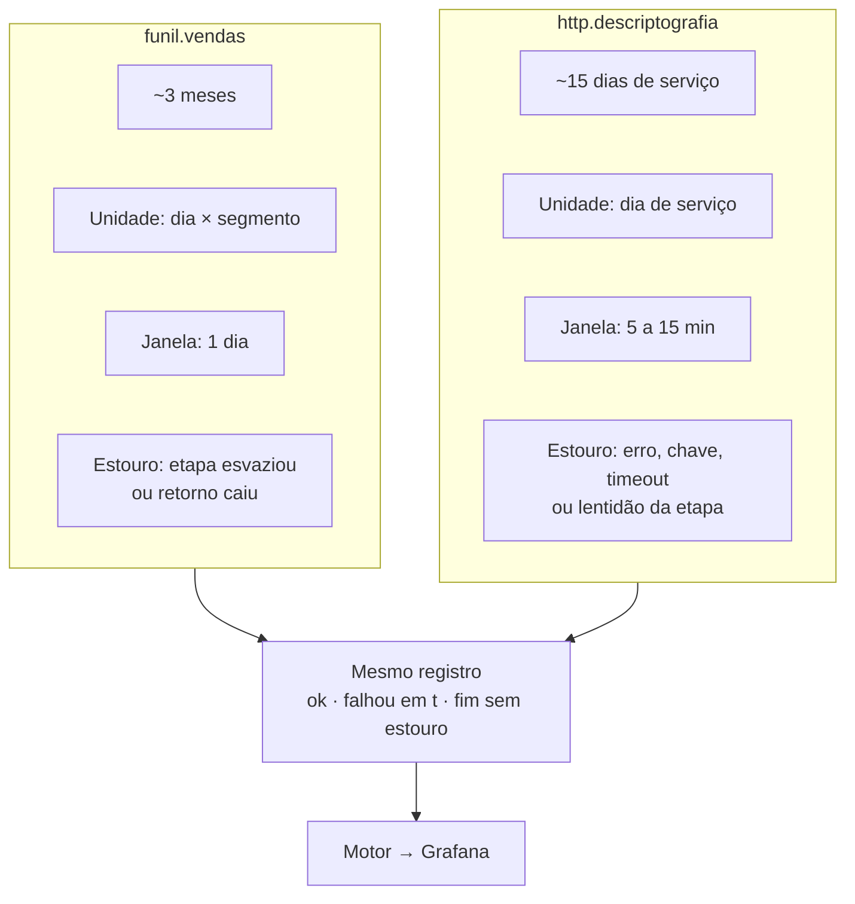

# Caixa fechada — funil de vendas e descriptografia HTTPS

Um motor calcula os indicadores. O adaptador só traduz o arquivo. Trocar de funil de vendas para descriptografia HTTPS troca a fonte e o critério de falha. A conta e os painéis ficam.

O texto de apresentação, com janela, censura, MTBF e MTTR, está no [README](../README.md). As colunas estão em [`plugin-preditivo-confiabilidade.md`](./plugin-preditivo-confiabilidade.md).

---

## 1. A metáfora

```text
                    ┌─────────────────────────────────────────┐
   FONTE ──────────▶│                                         │
   FailureSpec ────▶│              CAIXA FECHADA              │──────▶ Grafana
   UnitRecord* ────▶│   ① taxa × janela                       │
                    │   ② tempo até o 1º estouro (Weibull)    │
                    │   ③ P(S > L)                            │
                    └─────────────────────────────────────────┘
         ▲                              ▲
         │                              │
   funil.vendas                  http.descriptografia
   ~3 meses de etapas            só a abertura do dado
```

\* O adaptador emite uma unidade por dia (e, no funil, por segmento). Quem usa o plugin não ajusta a Weibull à mão.

---

## 2. Portas



---

## 3. Os dois adaptadores



| | Funil de vendas | Descriptografia HTTPS |
| --- | --- | --- |
| Identificador | `funil.vendas` | `http.descriptografia` |
| O que a linha representa | Uma etapa da jornada | Uma operação que abre o dado |
| Arquivo | `data/funil/eventos.csv` | `data/http/descriptografia.csv` |
| Horizonte | Cerca de 3 meses | Cerca de 15 dias |
| Unidade | Dia × segmento opaco | Dia de serviço |
| Janela | 1 dia | 5 a 15 min, com volume mínimo |
| Fora do arquivo | Nome de conta, de campanha, de pessoa | Corpo, chave secreta, o resto da API |

O caminho medido na descriptografia é só o miolo:

```text
front → API → [descriptografia] → banco, modelo, gravação, interface
```

Pedir a chave a um serviço externo e abrir o envelope localmente são a mesma etapa. Login, modelo e interface não geram linha neste adaptador.

---

## 4. O que cada indicador responde

| Indicador | Funil, em três meses | Descriptografia, no dia |
| --- | --- | --- |
| **① Taxa × janela** | A queda da etapa, ou o retorno, passou do limite naquele dia? | A taxa de erro ou a lentidão da etapa passou do limite naqueles 5–15 min? |
| **② Tempo até o estouro** | Em que dia o segmento cruzou o limite pela primeira vez. Dia com tráfego e sem estouro fica censurado até o fim do arquivo | Em que minuto do dia a primeira janela ruim terminou. Dia limpo censura em 1440 min. Dia sem operação sai da amostra |
| **③ \(P(S>L)\)** | A meta da etapa ainda cobre a queda observada? | O objetivo da etapa ainda cobre a taxa ou a duração observadas? |

A fração de janelas dentro do objetivo, o MTBF e o MTTR saem dos mesmos episódios: sequências de janelas ruins. O [README](../README.md) explica os três com um exemplo numérico.

---

## 5. Como ligar

```mermaid
sequenceDiagram
  actor U as Quem usa o plugin
  participant Arq as Arquivo
  participant Ad as Adaptador
  participant Box as Caixa
  participant G as Grafana

  U->>Arq: Escolhe funil.vendas ou http.descriptografia
  U->>Arq: Anexa o CSV só com as colunas daquele adaptador
  U->>Ad: Declara janela, limite e mínimo de eventos
  Ad->>Box: Entrega as unidades
  Box->>G: Publica o relatório
  G->>U: Mostra o quadro de dias e a curva
```

1. Escolher o identificador.
2. Anexar a fonte. O repositório guarda o contrato. O arquivo real entra quando existir, sem linhas inventadas no lugar dele.
3. Declarar o `FailureSpec`.
4. Rodar adaptador e motor.
5. Abrir o Grafana. O quadro é o estado de cada unidade. A curva é o tempo até o primeiro estouro.
