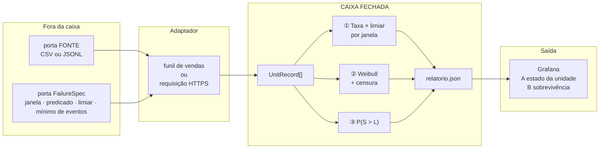
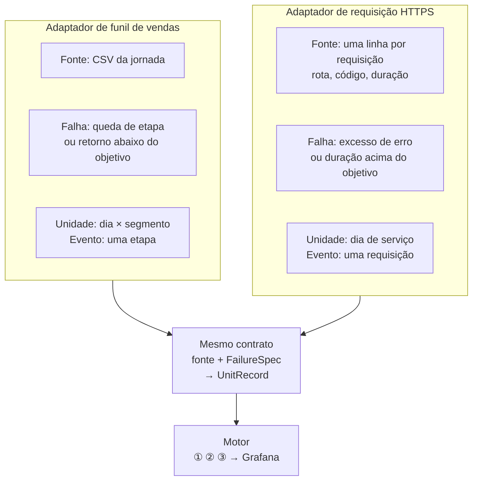
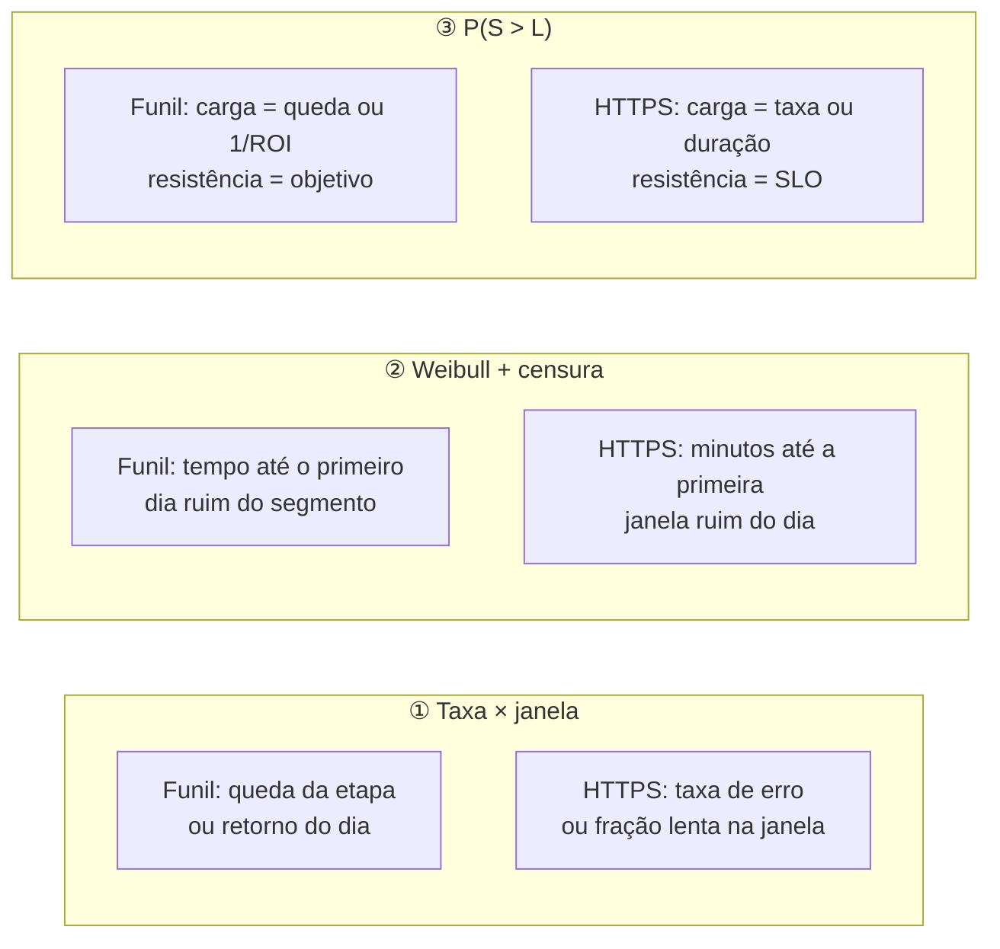
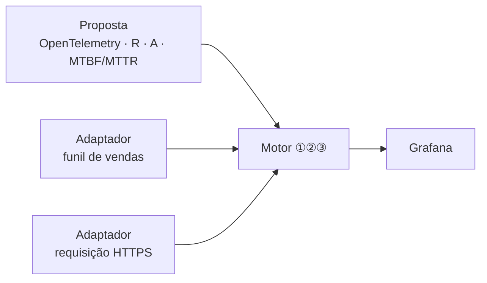

# Caixa fechada — adaptador de funil de vendas e adaptador de requisição HTTPS

Um motor só calcula os indicadores do EEE 017. Do lado de fora entram a fonte e o critério de falha. Do lado de dentro a conta não muda. Quem escolhe o cenário é o adaptador: **funil de vendas** ou **requisição HTTPS**.

O guia do que inserir, do que o painel mostra e da vantagem de cada adaptador está em [`plugin-preditivo-confiabilidade.md`](./plugin-preditivo-confiabilidade.md).

---

## 1. A metáfora

```text
                    ┌─────────────────────────────────────────┐
   FONTE ──────────▶│                                         │
   FailureSpec ────▶│         CAIXA FECHADA DO TP             │──────▶ Grafana
   UnitRecord* ────▶│   ① taxa×janela · ② Weibull + censura   │
                    │   ③ carga–resistência P(S>L)            │
                    └─────────────────────────────────────────┘
         ▲                              ▲
         │                              │
   adaptador de                  adaptador de
   funil de vendas               requisição HTTPS
```

\* O adaptador lê o arquivo e emite `UnitRecord[]`. Quem usa o plugin escolhe o adaptador e anexa os dados. O ajuste fica no motor.

---

## 2. Portas



---

## 3. Os dois adaptadores



| | Funil de vendas | Requisição HTTPS |
| --- | --- | --- |
| Identificador | `funil.vendas` | `http.request` |
| Pergunta | Em que etapa a jornada esvazia, e se o dia daquele segmento piorou | A requisição foi atendida, e em quanto tempo |
| Arquivo | `data/funil/eventos.csv` | `data/http/requisicoes.csv` |
| Unidade | dia × segmento opaco | dia de serviço |
| Janela de partida | 1 dia | 5 min, com pelo menos 100 requisições |
| O que a caixa recebe | `UnitRecord[]` no mesmo formato | `UnitRecord[]` no mesmo formato |

---

## 4. Indicadores



| Indicador | Funil de vendas | Requisição HTTPS |
| --- | --- | --- |
| **① Taxa × janela** | Queda da etapa, ou ROI, contra o limiar da própria série ou o objetivo declarado | \(R_{\mathrm{erro}}\) e \(R_{\mathrm{lat}}\) da janela contra \(99\%\) e \(95\%\) |
| **② Weibull** | Unidade dia × segmento. Segmento que atravessa o período sem estouro fica censurado | Unidade dia. Dia limpo censura em 1440 min. Dia sem tráfego sai da amostra |
| **③ \(P(S>L)\)** | \(L\) é a queda ou \(1/\mathrm{ROI}\). \(S\) é a meta daquela etapa ou do retorno | \(L\) é a taxa de erro ou a duração. \(S\) é o SLO declarado |

Os índices da proposta saem dos mesmos registros: confiabilidade por evento \(R = 1 - f/n\), fração de janelas dentro do objetivo, MTBF e MTTR dos episódios de janelas ruins seguidas.

---

## 5. Como ligar um cenário

```mermaid
sequenceDiagram
  actor U as Quem usa o plugin
  participant Arq as Arquivo
  participant Ad as Adaptador
  participant Box as Caixa
  participant G as Grafana

  U->>Arq: 1. Escolhe funil de vendas ou requisição HTTPS
  U->>Arq: 2. Anexa o CSV com as colunas daquele adaptador
  U->>Ad: 3. Declara o objetivo, a janela e o mínimo de eventos
  Ad->>Box: 4. Entrega UnitRecord e o FailureSpec
  Box->>Box: 5. Calcula taxa, Weibull e P(S>L)
  Box->>G: 6. Publica relatorio.json
  G->>U: 7. Mostra estado, disponibilidade e curva
```

1. Escolher `funil.vendas` ou `http.request`.
2. Anexar a fonte. O arquivo real ainda não está no repositório. O contrato de colunas está no [guia do plugin](./plugin-preditivo-confiabilidade.md).
3. Preencher o `FailureSpec`: janela, predicado, `threshold_mode` (`fixed_slo`, `rolling_p95`, `rolling_p80`, `rolling_p20`) e o mínimo de eventos.
4. Rodar o adaptador e o motor.
5. Abrir o Grafana. O painel A é o estado da unidade. O painel B é a sobrevivência.

---

## 6. Proposta e caixa

A [proposta do grupo](./grupo_1_proposal.pdf) descreve o estudo: sistema distribuído, falha vista por quem usa o serviço, plugin de Grafana com confiabilidade, disponibilidade e MTBF/MTTR. Os dois adaptadores são a forma genérica de alimentar esse plugin.


