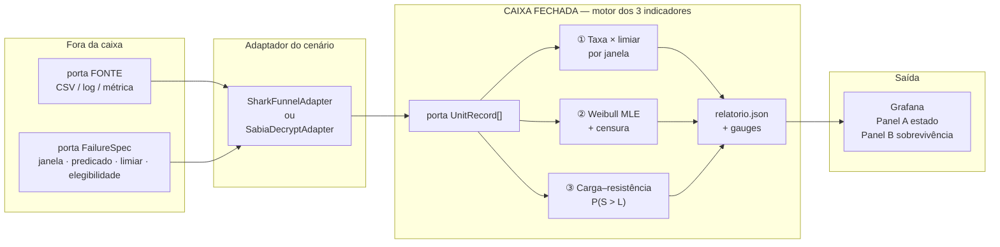
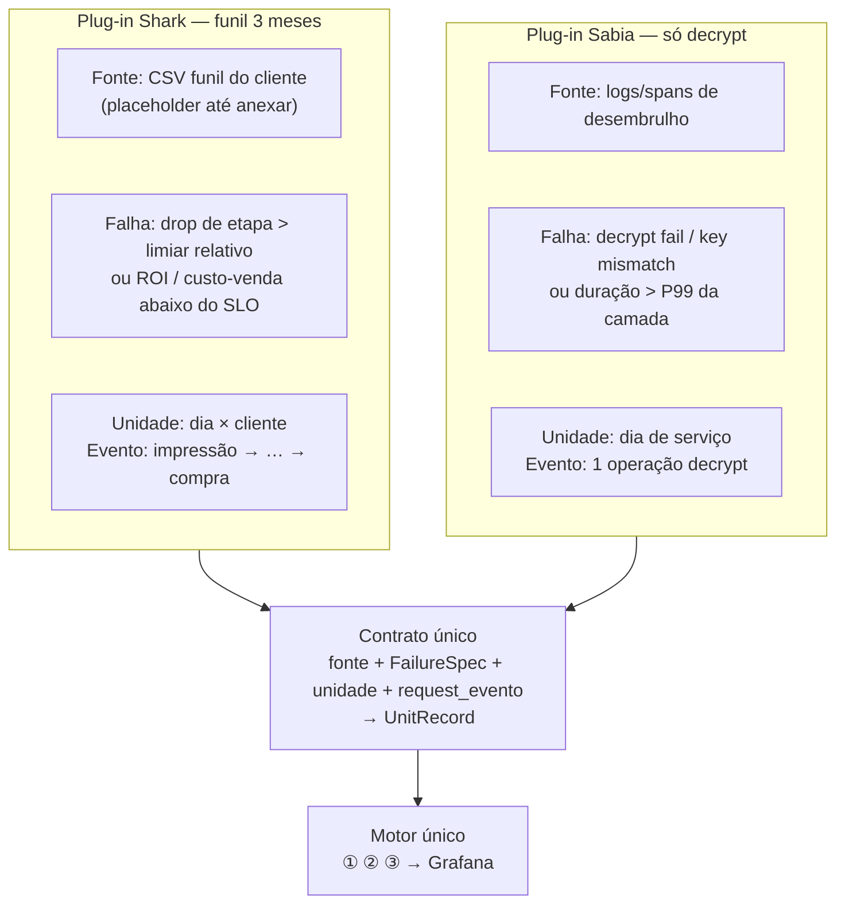
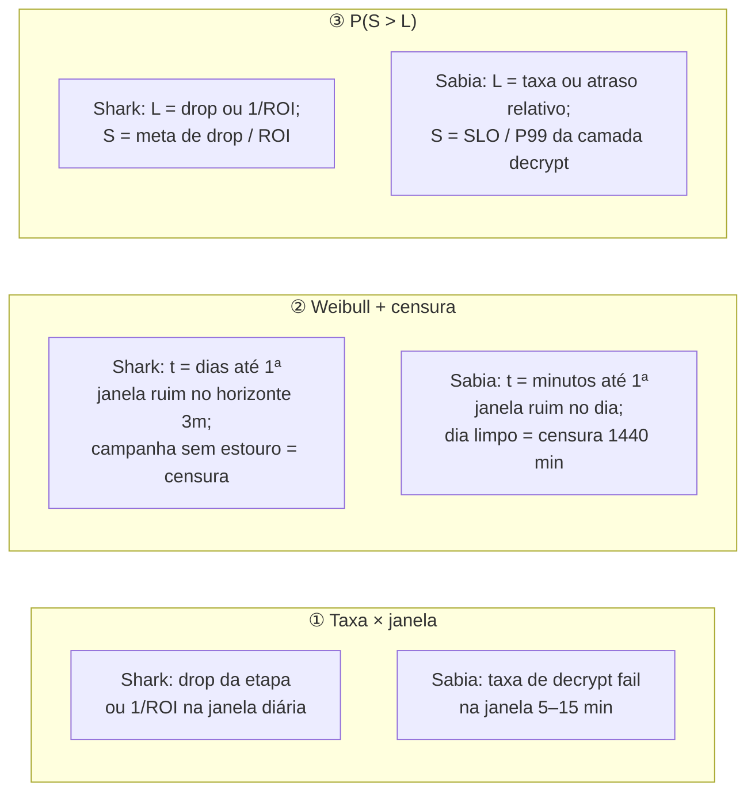
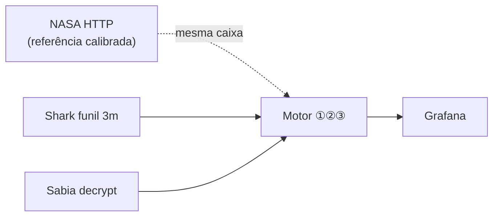

# TP em caixa fechada — Shark (funil 3m) × Sabia (decrypt)

Visão **visual** do trabalho: um motor único de confiabilidade (os 3 indicadores do EEE 017) dentro de uma **caixa fechada**. Do lado de fora só entram três portas padronizadas; do lado de dentro a matemática não muda. Dois **plug-ins de cenário** adaptam Shark e Sabia ao mesmo contrato.

Documento-irmão (contrato técnico + Grafana): [`plugin-preditivo-confiabilidade.md`](./plugin-preditivo-confiabilidade.md).

---

## 1. A metáfora

```text
                    ┌─────────────────────────────────────────┐
   FONTE ──────────▶│                                         │
   FailureSpec ────▶│         CAIXA FECHADA DO TP             │──────▶ Grafana
   UnitRecord* ────▶│   Ind.1 taxa×janela · Ind.2 Weibull     │         (A + B)
                    │   Ind.3 carga–resistência P(S>L)        │
                    └─────────────────────────────────────────┘
         ▲                              ▲
         │                              │
   plug-in Shark                 plug-in Sabia
   (funil 3 meses)               (só decrypt / desembrulho)
```

\* O adaptador do cenário emite `UnitRecord[]` a partir da fonte + `FailureSpec`. O usuário **não** calcula Weibull à mão: só pluga o cenário.

---

## 2. Diagrama — caixa com portas



---

## 3. Dois plug-ins, mesmo contrato



| | Shark | Sabia |
| --- | --- | --- |
| Escopo | Funil comercial de **3 meses** de um cliente | **Somente** requests de **desembrulho / descriptografia** |
| Fora de escopo | WhatsApp 1:1 (fase posterior) | KMS → LLM → encrypt → DB → UI |
| O que o usuário anexa | CSV do funil (schema abaixo) | Telemetria de decrypt (ou stub) |
| O que a caixa vê | `UnitRecord[]` idênticos em forma | `UnitRecord[]` idênticos em forma |

---

## 4. Contrato único de entrada (as três portas)

```text
ReliabilityInput = {
  fonte,             // onde estão os eventos brutos
  failure_spec,      // janela + predicado + limiar + elegibilidade
  unidade_amostral,  // o que “sobrevive” ou “falha”
  request_evento     // átomo contável
}

UnitRecord = {
  unit_id, t_min, censored, cause?, windows[], meta
}
```

Detalhe de campos e JSON estável: ver §1–§3 de [`plugin-preditivo-confiabilidade.md`](./plugin-preditivo-confiabilidade.md).

---

## 5. Mapeamento nos 3 indicadores



| Indicador | Shark (funil 3m) | Sabia (decrypt) |
| --- | --- | --- |
| **① Taxa/janela** | Drop na etapa (ou ROI) vs limiar relativo da etapa | Taxa de falha de decrypt vs P95 móvel da camada |
| **② Weibull** | Unidade `dia×cliente`; \(t\) até 1ª janela ruim; fim do funil sem estouro = censura | Unidade `dia`; \(t\) até 1ª janela ruim; dia sem limiar = censura |
| **③ \(P(S>L)\)** | \(L=\) drop ou 1/ROI; \(S=\) SLO de marketing | \(L=\) taxa ou \(d/\mathrm{P50}\); \(S=\) SLO/P99 decrypt |

---

## 6. O que anexar no repo (Shark — funil 3 meses)

**Não inventar CSV.** Até o arquivo real chegar, o repo carrega só o **contrato** + um stub de schema.

### Schema esperado (`data/shark/funil-3m.schema.json` — placeholder)

| Coluna | Tipo | Obrigatória | Significado |
| --- | --- | --- | --- |
| `timestamp` | ISO-8601 | sim | instante do evento |
| `cliente_id` | string | sim | segmenta a unidade `dia×cliente` |
| `campanha_id` | string | não | opcional para filtrar |
| `etapa` | enum | sim | `impressao` \| `cardapio` \| `carrinho` \| `checkout` \| `compra` |
| `evento_id` | string | sim | id único do evento |
| `sessao_id` | string | recomendado | amarra a jornada |
| `custo_anuncio` | number | se falha=ROI | custo atribuído |
| `receita` | number | se falha=ROI | receita da conversão (0 se não comprou) |
| `meta` | JSON/string | não | tags livres |

Arquivo de dados (quando o usuário anexar):

```text
data/shark/funil-3m.csv          ← real (ainda não presente)
data/shark/funil-3m.PLACEHOLDER  ← marca “anexar aqui”; sem linhas inventadas
data/shark/funil-3m.schema.md    ← este contrato
```

### Sabia decrypt — schema mínimo de telemetria

| Campo | Tipo | Significado |
| --- | --- | --- |
| `timestamp` | ISO-8601 | instante do decrypt |
| `status` | `ok` \| `fail` \| `key_mismatch` \| `timeout` | resultado |
| `duracao_ms` | number | duração da operação |
| `chave_id` | string | id lógico da chave (sem segredo) |
| `request_id` | string | correlação |

---

## 7. Passo a passo visual — como ligar o cenário

```mermaid
sequenceDiagram
  actor U as Usuário
  participant Repo as Repo / data/
  participant Ad as Adaptador
  participant Box as Caixa fechada
  participant G as Grafana

  U->>Repo: 1. Escolhe cenário (Shark | Sabia)
  U->>Repo: 2. Anexa fonte (CSV funil 3m ou telemetria decrypt)
  U->>Ad: 3. Declara FailureSpec (janela, limiar relativo, elegibilidade)
  Ad->>Ad: 4. Mapeia eventos → UnitRecord[]
  Ad->>Box: 5. Empurra UnitRecord + FailureSpec pelas portas
  Box->>Box: 6. Roda ① taxa ② Weibull ③ P(S>L)
  Box->>G: 7. Emite relatorio.json / gauges
  G->>U: 8. Panel A (estado) + Panel B (R(t), KM, amostra)
```

### Checklist operacional

1. **Escolher plug-in** — `shark.funnel_3m` ou `sabia.decrypt`.
2. **Anexar fonte** — CSV real do funil **ou** export de decrypt; se Shark ainda não chegou, deixar o placeholder e documentar o path.
3. **Preencher `FailureSpec`** — janela, predicado, `threshold_mode` (`rolling_p95` | `fixed_slo`), `eligibility` (mín. de eventos).
4. **Rodar adaptador** — produz `UnitRecord[]` (sem inventar falhas; dia sem dado = excluído, não censura).
5. **Rodar motor** — Python (MLE fora do browser).
6. **Abrir Grafana** — Panel A = OK/Falhou/\(t\)/Censurado; Panel B = β, η, KM, \(P(S>L)\).
7. **Trocar cenário** — só troca adaptador + fonte + spec; a caixa e os painéis permanecem.

---

## 8. NASA como calibrador (não é o 3º produto)

A caixa já foi calibrada no experimento NASA-HTTP. Shark e Sabia **reutilizam** a mesma matemática; não são um segundo/terceiro TP. Na apresentação: “mesma caixa, dois plug-ins de domínio”.


